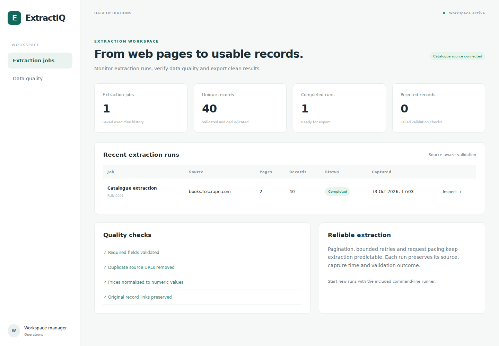
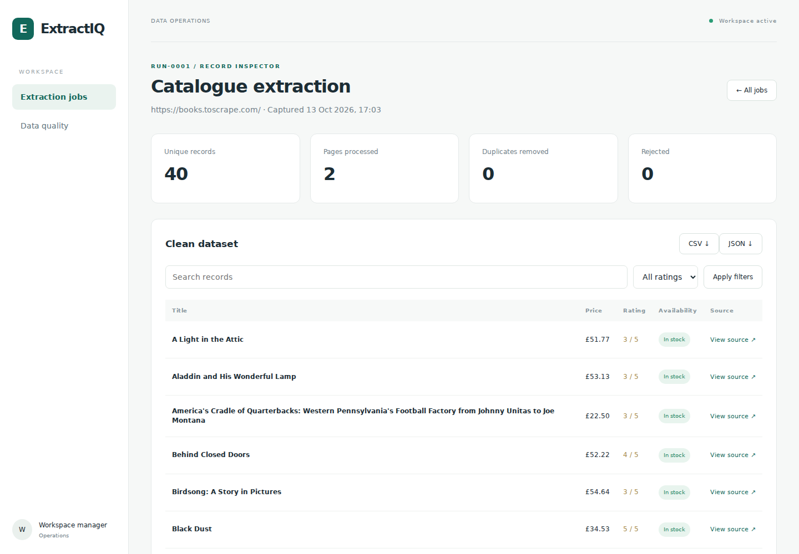
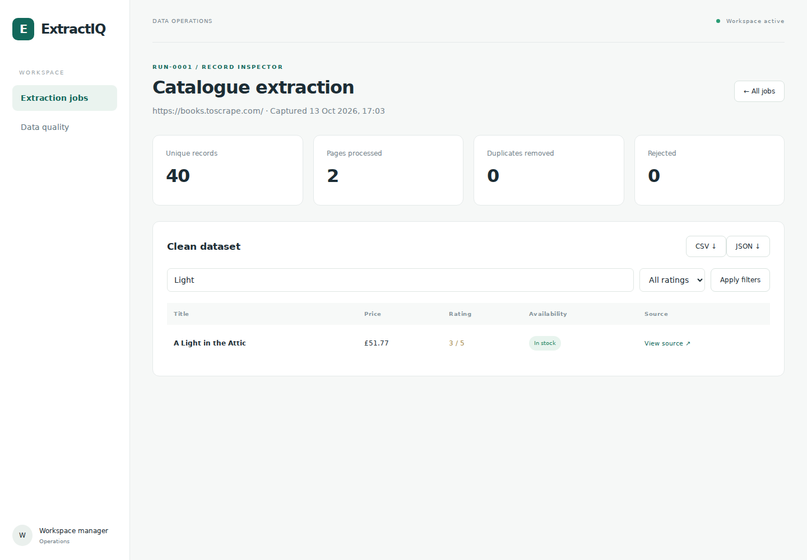

# ExtractIQ — Web Extraction & Data Quality Console

## The problem

Raw web data needs validation, deduplication and traceable source links before it can be used in analysis or operational workflows.

## The solution

ExtractIQ collects paginated catalogue records through an approved-source runner. It normalizes prices, validates required fields and removes duplicate URLs, then stores job history and clean records for review.

- Source restrictions and robots checks
- Request pacing, timeouts and bounded retries
- Pagination and validation metrics
- Authenticated, owner-scoped job access
- Record search, rating filters and original source links
- CSV and JSON exports

New runs execute through the command-line runner. The console does not claim a browser-based scraping trigger or an enabled scheduler.

## Screenshots

## Explore the implementation

[Extraction runner](app/core/scraper.py) · [Command](app/core/management/commands/crawl_catalogue.py) · [CSV output](output/catalogue.csv) · [JSON output](output/catalogue.json) · [Run locally](SETUP.md)

## Source and validation

The actual HTTP extraction captured 40 unique records from two pages of [Books to Scrape](https://books.toscrape.com/), a public scraping-practice catalogue. Prices and ratings are illustrative source data, not commercial market pricing. There were zero rejected records in this run.

This is an independent project. This repository page is a source walkthrough, not a live hosted application.
